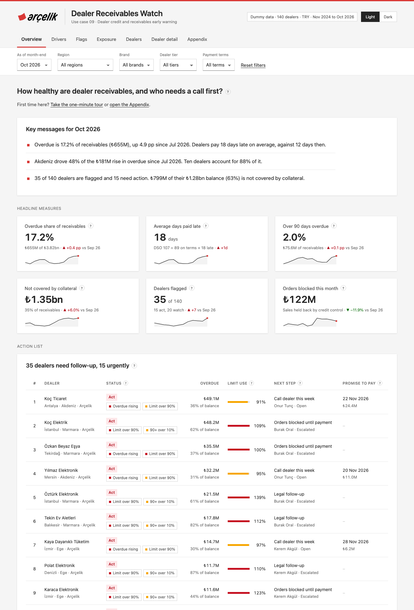

# Dealer Receivables Watch · Arçelik use case 09

> **Course assignment.** This is a student project built for a course brief, not an Arçelik product. It is not affiliated with or endorsed by Arçelik A.Ş. **All data is invented** (dummy dataset, fixed random seed); no real dealer, customer or company figures are used.

A descriptive early-warning dashboard for dealer credit and receivables: which dealers are drifting toward trouble, why, and how much exposure sits behind them.

- **Live copy:** https://claude.ai/artifact/B4PadJtNYHR8RX53cXUydG
- **Offline copy:** open `Dealer_Receivables_Watch.html` in any browser.
- **One-page note:** `note/Note_UC09_Dealer_Receivables.pdf`

## Warning flags
| Flag | Rule |
|---|---|
| Overdue rising | Overdue up 3 months in a row (≥5% each, ≥₺250k) |
| Limit pressure | Credit limit use above 90% |
| Aged debt | 90+ days overdue above 10% of balance |

A dealer with 2 or more flags is marked **Act**.

## Contents
| Path | What it is |
|---|---|
| `dashboard.html` | Dashboard source (reads `data.js`) |
| `Dealer_Receivables_Watch.html` | Single-file offline build |
| `data/` | 7 CSV tables, May 2024 – Oct 2026, plus a data dictionary |
| `generate_data.py` | Regenerates the dummy dataset |
| `build_standalone.py` | Bundles the offline file |
| `build.sh` | Rebuilds everything: data, bundle, checks, screenshots, PDF note, hand-in zip (macOS, needs Python 3, Node and Chrome) |
| `screenshots/` | Every page in light and dark mode |
| `note/` | One-page note source and PDF |

## Screenshots

